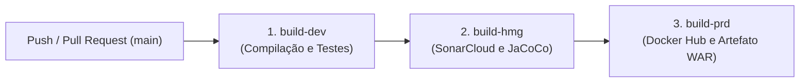

[](https://github.com/osmarbraz/controle_de_estoque_java/actions) 
[](https://sonarcloud.io/summary/new_code?id=osmarbraz_controle_de_estoque_java)
[](https://sonarcloud.io/component_measures?id=osmarbraz_controle_de_estoque_java&metric=coverage)
[](https://hub.docker.com/r/osmarbraz/controle_de_estoque_java)

# Sistema de Controle de Estoque & Pedidos (SCEP)

Sistema web desenvolvido em **Java** para gerenciamento de clientes, cidades, categorias, produtos, estoque, pedidos e itens de pedidos.

O projeto utiliza uma arquitetura baseada em **JSP + Servlets + DAO + MySQL**, com o **Apache Maven** para gerenciamento de dependências, compilação e deploy, e o **Apache Tomcat** como servidor web.

---

## Objetivo

O **Sistema de Controle de Estoque & Pedidos (SCEP)** tem como objetivo permitir o gerenciamento de:

* Clientes;
* Cidades;
* Categorias de produtos;
* Produtos;
* Estoque;
* Pedidos;
* Itens dos pedidos;
* Relatórios gerenciais.

O sistema deve possuir uma interface web simples, padronizada e responsiva, utilizando **JSP**, **CSS** e **JavaScript**.

---

## Requisitos Funcionais

### Módulo de Cidades

| Código | Descrição |
|--------|-----------|
| **RF001** | O sistema deve permitir listar todas as cidades cadastradas. |
| **RF002** | O sistema deve permitir cadastrar uma nova cidade informando nome e UF. |
| **RF003** | O sistema deve permitir editar os dados de uma cidade existente. |
| **RF004** | O sistema deve permitir excluir uma cidade, desde que não esteja vinculada a nenhum cliente. |

### Módulo de Categorias

| Código | Descrição |
|--------|-----------|
| **RF005** | O sistema deve permitir listar todas as categorias de produtos. |
| **RF006** | O sistema deve permitir cadastrar uma nova categoria de produto informando o nome. |
| **RF007** | O sistema deve permitir editar os dados de uma categoria existente. |
| **RF008** | O sistema deve permitir excluir uma categoria, desde que não esteja vinculada a nenhum produto. |

### Módulo de Clientes

| Código | Descrição |
|--------|-----------|
| **RF009** | O sistema deve permitir listar todos os clientes cadastrados com CPF, endereço e cidade/UF. |
| **RF010** | O sistema deve permitir cadastrar um novo cliente informando nome, CPF, rua, número, bairro e cidade. |
| **RF011** | O sistema deve permitir editar os dados de um cliente existente. |
| **RF012** | O sistema deve permitir excluir um cliente, desde que não possua pedidos vinculados. |

### Módulo de Produtos

| Código | Descrição |
|--------|-----------|
| **RF013** | O sistema deve permitir listar todos os produtos com descrição, unidade, preço de custo, preço de venda, saldo de estoque e categoria. |
| **RF014** | O sistema deve permitir cadastrar um novo produto informando descrição, unidade, preço de custo, preço de venda, quantidade em estoque e categoria. |
| **RF015** | O sistema deve permitir editar os dados de um produto existente. |
| **RF016** | O sistema deve permitir excluir um produto, desde que não esteja associado a nenhum item de pedido. |
| **RF017** | O sistema deve oferecer uma API de busca de produtos por descrição (endpoint JSON) para suportar seleção dinâmica de produtos na interface de itens de pedido. |
| **RF018** | O sistema deve atualizar automaticamente o saldo de estoque do produto ao adicionar ou remover um item de pedido, ou ao alterar a situação do pedido. |

### Módulo de Pedidos

| Código | Descrição |
|--------|-----------|
| **RF019** | O sistema deve permitir listar todos os pedidos com identificador, cliente, data, situação e valor total. |
| **RF020** | O sistema deve permitir cadastrar um novo pedido informando o cliente, a data e a situação inicial (aberto). |
| **RF021** | O sistema deve permitir editar o cabeçalho de um pedido (cliente e situação), enquanto o pedido estiver em aberto. |
| **RF022** | O sistema deve permitir alterar a situação de um pedido entre **aberto** e **fechado**, ajustando automaticamente o saldo de estoque dos produtos envolvidos. |
| **RF023** | O sistema deve permitir excluir um pedido e seus respectivos itens em cascata. |
| **RF024** | O sistema deve permitir visualizar os detalhes de um pedido individual, incluindo todos os seus itens. |

### Módulo de Itens de Pedido

| Código | Descrição |
|--------|-----------|
| **RF025** | O sistema deve permitir adicionar itens a um pedido, informando produto, quantidade e preço de venda. |
| **RF026** | O sistema deve impedir a adição de itens a pedidos com situação **fechada**. |
| **RF027** | O sistema deve recalcular automaticamente o valor total do pedido ao adicionar ou remover um item. |
| **RF028** | O sistema deve permitir remover um item de pedido, restaurando a quantidade correspondente ao estoque do produto. |

### Módulo de Relatórios

| Código | Descrição |
|--------|-----------|
| **RF029** | O sistema deve disponibilizar um painel central de relatórios com acesso a todos os relatórios disponíveis. |
| **RF030** | O sistema deve gerar um relatório de cidades com visualização web e exportação para planilha Excel (.xls). |
| **RF031** | O sistema deve gerar um relatório de categorias com visualização web e exportação para planilha Excel (.xls). |
| **RF032** | O sistema deve gerar um relatório de clientes com visualização web e exportação para planilha Excel (.xls). |
| **RF033** | O sistema deve gerar um relatório de produtos com visualização web e exportação para planilha Excel (.xls). |
| **RF034** | O sistema deve gerar um relatório analítico de todos os pedidos e seus itens, com visualização web e exportação para planilha Excel (.xls). |
| **RF035** | O sistema deve gerar um relatório de pedidos em aberto e seus itens, com visualização web e exportação para planilha Excel (.xls). |
| **RF036** | O sistema deve gerar um relatório de pedidos fechados e seus itens, com visualização web e exportação para planilha Excel (.xls). |

---

## Requisitos Não Funcionais

### Arquitetura e Tecnologia

| Código | Descrição |
|--------|-----------|
| **RNF001** | O sistema deve ser implementado em **Java**, utilizando a arquitetura **JSP + Servlets + DAO**, seguindo o padrão MVC. |
| **RNF002** | O sistema deve utilizar **MySQL 8.0** como banco de dados relacional, com tabelas criadas e verificadas automaticamente na inicialização da aplicação. |
| **RNF003** | O sistema deve ser implantado em **Apache Tomcat** e empacotado como arquivo WAR, gerenciado pelo **Apache Maven**. |
| **RNF004** | O sistema deve ser conteinerizado com **Docker** e orquestrado via **Docker Compose**, permitindo execução isolada dos serviços de aplicação e banco de dados. |

### Interface e Usabilidade

| Código | Descrição |
|--------|-----------|
| **RNF005** | A interface web deve ser responsiva, padronizada e acessível via navegador, utilizando **HTML5**, **CSS3 (Vanilla CSS)** e **JavaScript**. |
| **RNF006** | A interface deve exibir mensagens de feedback ao usuário para operações de sucesso, erro e validação. |
| **RNF007** | Os formulários de cadastro devem reutilizar o mesmo componente visual para inserção e edição de registros. |

### Configuração e Portabilidade

| Código | Descrição |
|--------|-----------|
| **RNF008** | A configuração de conexão com o banco de dados deve suportar três níveis de prioridade: variáveis de ambiente (`DB_HOST`, `DB_PORT`, `DB_NAME`, `DB_USER`, `DB_PASSWORD`), propriedades de sistema JVM e arquivo `db.properties`, nesta ordem. |
| **RNF009** | O sistema deve carregar dados iniciais de demonstração automaticamente no banco de dados quando estiver vazio, sem necessidade de scripts manuais. |

### Qualidade e Testes

| Código | Descrição |
|--------|-----------|
| **RNF010** | O código-fonte deve possuir testes automatizados unitários cobrindo as camadas de controle (Servlets) e acesso a dados (DAOs), utilizando **JUnit 5** e **Mockito**. |
| **RNF011** | O projeto deve integrar **JaCoCo** para medição e relatório de cobertura de testes, executado automaticamente no ciclo de build Maven. |
| **RNF012** | O projeto deve possuir integração contínua configurada via **GitHub Actions**, executando automaticamente compilação, testes e análise de qualidade de código com **SonarCloud** a cada push ou pull request. |

---

## Tecnologias Utilizadas

* **Linguagem:** Java 8
* **Arquitetura Web:** JSP (JavaServer Pages 2.3), JSTL 1.2 e Servlets (Servlet API 3.1)
* **Padrão Arquitetural:** MVC (Model-View-Controller) com camada DAO (Data Access Object)
* **Banco de Dados:** MySQL 8.0 (com driver MySQL Connector/J 8.0.33)
* **Serialização / API REST:** Google Gson 2.10.1
* **Gerenciador de Dependências e Build:** Apache Maven
* **Servidor de Aplicação Web:** Apache Tomcat 9.0 (Docker) / Tomcat 7 (Maven Plugin)
* **Conteinerização:** Docker & Docker Compose
* **Testes Automatizados:** JUnit 5 e Mockito
* **Cobertura de Código:** JaCoCo
* **CI/CD e Qualidade de Código:** GitHub Actions (Pipelines automatizados de CI/CD), SonarCloud e Jib (Build e push da imagem Docker)
* **Interface:** HTML5, CSS3 (Vanilla CSS) e JavaScript (ES6)

---

## Estrutura do Projeto

```text
controle_de_estoque/
├── .github/
│   └── workflows/
│       └── maven.yml           # Pipeline de CI/CD automatizado no GitHub Actions
├── src/
│   ├── main/
│   │   ├── java/com/estoque/
│   │   │   ├── configuracao/   # Conexão JDBC e inicializador do banco
│   │   │   ├── controle/       # Servlets (Controllers das rotas web e API)
│   │   │   ├── dao/            # Data Access Objects (persistência SQL)
│   │   │   ├── modelo/         # Entidades de domínio (POJOs)
│   │   │   └── web/            # Listeners de ciclo de vida da aplicação
│   │   ├── resources/          # Arquivo db.properties e configurações
│   │   └── webapp/             # Páginas JSP, estilos CSS e componentes de interface
│   │       ├── includes/       # Cabeçalho, rodapé e barra de navegação
│   │       ├── relatorios/     # Telas dos relatórios gerenciais e XLS
│   │       ├── cliente/        # Telas de formulário e listagem de clientes
│   │       ├── produto/        # Telas de produtos
│   │       ├── pedido/         # Telas de pedidos e itens de pedido
│   │       ├── categoria/      # Telas de categorias
│   │       └── cidade/         # Telas de cidades
│   └── test/java/com/estoque/  # Suíte completa de testes unitários (JUnit 5 + Mockito)
├── compose.yml                 # Definição dos serviços Docker (MySQL e Tomcat)
├── Dockerfile                  # Construção da imagem Docker da aplicação
├── banco.sql                   # Script SQL de referência (DDL e dados de exemplo)
└── pom.xml                     # Configuração Maven, dependências e plugins
```

---

## Dados Iniciais de Demonstração (Seed Data)

Ao iniciar a aplicação com o banco de dados vazio, o sistema executa automaticamente a classe `BancoDeDadosInicializador`, populando os seguintes dados para testes e validação:

* **Cidades (4):** São Paulo/SP, Rio de Janeiro/RJ, Belo Horizonte/MG, Curitiba/PR.
* **Categorias (5):** Informática, Eletrônicos, Alimentos, Bebidas, Escritório.
* **Clientes (3):** João da Silva, Maria Fernandes, Carlos Souza.
* **Produtos (6):** Teclado Mecânico RGB, Mouse Sem Fio, Monitor UltraWide 29, Café Gourmet 500g, Caixa de Água Mineral, Cadeira Ergonômica.
* **Pedidos de Demonstração (2):**
  * **Pedido 1 (Situação: Aberto):** Cliente João da Silva — 2 itens (Teclado Mecânico + Mouse Sem Fio) — Total: R$ 289,80.
  * **Pedido 2 (Situação: Fechado):** Cliente Maria Fernandes — 3 itens (Monitor UltraWide + 2x Café Gourmet + Cadeira Ergonômica) — Total: R$ 1.807,80 (com saldos de estoque correspondentes já baixados).

---

## Pré-requisitos

Para compilar e executar o projeto, certifique-se de possuir instalado:

* [Git](https://git-scm.com/)
* [Java JDK 8](https://www.oracle.com/java/technologies/javase/javase-jdk8-downloads.html) (ou superior compatível com Java 8 bytecode)
* [Apache Maven 3.6+](https://maven.apache.org/)
* [Docker Desktop](https://www.docker.com/products/docker-desktop/) (caso opte pela execução via contêineres)
* [MySQL Server 8.0](https://dev.mysql.com/downloads/mysql/) (necessário apenas se executar localmente via Maven sem Docker)

---

## Configuração do Banco de Dados

A conexão com o banco de dados suporta configuração dinâmica através de **variáveis de ambiente**, facilitando o uso tanto no Docker quanto em ambientes locais:

| Variável de Ambiente | Descrição | Valor Padrão (Local) | Valor no Docker Compose |
|----------------------|-----------|----------------------|-------------------------|
| `DB_HOST` | Host do servidor MySQL | `localhost` | `mysql` |
| `DB_PORT` | Porta de conexão | `3306` | `3306` |
| `DB_NAME` | Nome do banco de dados | `EstoqueDB` | `EstoqueDB` |
| `DB_USER` | Usuário do MySQL | `root` | `root` |
| `DB_PASSWORD` | Senha do MySQL | `root` | `root` |

> Caso nenhuma variável de ambiente seja definida, a aplicação utilizará as configurações contidas em `src/main/resources/db.properties`.
> Um script SQL de referência para criação manual das tabelas também está disponível em [banco.sql](banco.sql).

---

## Testes Automatizados e Cobertura de Código

O projeto conta com ampla suíte de testes unitários automatizados cobrindo as camadas de modelo, controle (Servlets) e persistência (DAOs).

### Executar os testes:
```bash
mvn clean test
```

### Visualizar o relatório de cobertura JaCoCo:
Após a execução dos testes, o JaCoCo gera o relatório em HTML. Abra no navegador:
```text
target/site/jacoco/index.html
```

---

## Integração e Entrega Contínua (CI/CD com GitHub Actions)

O projeto conta com uma esteira automatizada de **Integração Contínua (CI)** e **Entrega Contínua (CD)** configurada através do arquivo de workflow [maven.yml](.github/workflows/maven.yml), acionada a cada evento de **push** ou **pull request** direcionado à branch `main`.

A esteira foi projetada em três ambientes (*jobs*) sequenciais e dependentes, garantindo validação rápida, análise detalhada de qualidade e entrega automatizada de artefatos:



### Detalhamento dos Ambientes e Jobs:

1. **`build-dev` — Ambiente de Desenvolvimento e Testes Unitários:**
   * **Runner:** Ubuntu 24.04 (`ubuntu-24.04`).
   * **Ambiente GitHub:** `dev`.
   * **Configuração:** Java JDK 18 (distribuição Eclipse Temurin) com cache inteligente do Maven via `actions/setup-java@v5`.
   * **Comando:** `mvn -B test --file pom.xml`.
   * **Finalidade:** Compilar o projeto e executar toda a suíte de testes unitários automatizados (JUnit 5 + Mockito). Fornece feedback imediato em caso de erros de compilação ou quebra de regras de negócio.

2. **`build-hmg` — Ambiente de Homologação e Análise de Qualidade:**
   * **Runner:** Ubuntu 24.04 (`ubuntu-24.04`).
   * **Ambiente GitHub:** `hmg` (acionado somente após aprovação do job `build-dev`).
   * **Configuração:** Checkout com profundidade total de histórico (`fetch-depth: 0`) para inspeção estática precisa, além de cache dos pacotes do SonarCloud (`~/.sonar/cache`) e dependências do Maven (`~/.m2`) via `actions/cache@v5`.
   * **Comando:** `mvn -B verify org.sonarsource.scanner.maven:sonar-maven-plugin:sonar -Dsonar.projectKey=osmarbraz_controle_de_estoque_java org.jacoco:jacoco-maven-plugin:prepare-agent -Dsonar.coverage.jacoco.xmlReportPaths=target/site/jacoco/jacoco.xml`.
   * **Finalidade:** Realizar a análise estática de código com o **SonarCloud** e consolidar o relatório de cobertura de testes gerado pelo **JaCoCo**, validando se as métricas atendem ao *Quality Gate* definido.

3. **`build-prd` — Ambiente de Produção, Container e Empacotamento:**
   * **Runner:** Ubuntu 24.04 (`ubuntu-24.04`).
   * **Ambiente GitHub:** `prd` (acionado após o sucesso do job `build-hmg`).
   * **Ações:**
     * **Empacotamento e Publicação de Imagem Docker:** Utiliza o plugin Maven Google Jib (`mvn -B package --file pom.xml jib:build -DskipTests`) para compilar a aplicação, gerar a imagem Docker otimizada e publicá-la automaticamente no [Docker Hub](https://hub.docker.com/r/osmarbraz/controle_de_estoque_java).
     * **Publicação de Artefato Compilado (.WAR):** Cria uma pasta temporária de *staging*, copia o pacote gerado (`target/*.war`) e publica o arquivo compactado (`Package-Linux.zip`) como artefato da execução do workflow através da action `actions/upload-artifact@v7`.

### Segredos (Secrets) Necessários no GitHub

Para a execução completa de todas as etapas da esteira, os seguintes segredos (*Repository Secrets*) devem estar devidamente configurados no repositório GitHub (**Settings > Secrets and variables > Actions**):

| Secret | Descrição | Utilizado no Job |
|--------|-----------|------------------|
| `GITHUB_TOKEN` | Token padrão gerado pelo GitHub para leitura de metadados e permissões de status. | `build-hmg` |
| `SONAR_TOKEN` | Token de autenticação da conta/organização no [SonarCloud](https://sonarcloud.io/). | `build-hmg` |
| `DOCKERHUB_USERNAME` | Nome de usuário da conta no [Docker Hub](https://hub.docker.com/). | `build-prd` |
| `DOCKERHUB_TOKEN` | Personal Access Token (PAT) gerado no Docker Hub com permissão de escrita (*push* de imagens). | `build-prd` |

---

## Como Executar a Aplicação

### Opção 1: Execução com Docker (Recomendado)

Utilize o terminal (PowerShell ou Bash) no diretório raiz do projeto:

#### 1. Construir o pacote da aplicação (WAR):
> **Importante:** Este passo é obrigatório antes do build Docker, pois a imagem necessita do arquivo `target/controle-de-estoque.war`.
```bash
mvn clean package
```

#### 2. Subir os contêineres (MySQL + Tomcat):
```bash
docker compose up --build
```
> Para rodar em segundo plano (detached mode), adicione o parâmetro `-d`:
> ```bash
> docker compose up -d --build
> ```

#### 3. Acessar a aplicação no navegador:
* URL: [http://localhost:8080/](http://localhost:8080/)

#### 4. Visualizar os logs dos serviços:
```bash
docker compose logs -f
```

#### 5. Parar os serviços:
```bash
docker compose down -v
```

#### 6. Remover imagens criadas:
```bash
docker compose down --rmi all
```

---

### Opção 2: Execução Local com Maven (Tomcat Plugin)

Caso prefira rodar sem Docker, é necessário ter o **MySQL 8.0 ativo localmente** na porta 3306 com o usuário e senha configurados.

#### 1. Construir a aplicação:
```bash
mvn clean package
```

#### 2. Iniciar o servidor embutido via Tomcat Maven Plugin:
```bash
mvn tomcat7:run
```

#### 3. Acessar a aplicação no navegador:
* URL: [http://localhost:8080/controle_de_estoque_java/](http://localhost:8080/controle_de_estoque_java/)

#### 4. Encerrar a aplicação:
Pressione `Ctrl + C` no terminal ou execute:
```bash
mvn tomcat7:undeploy
```